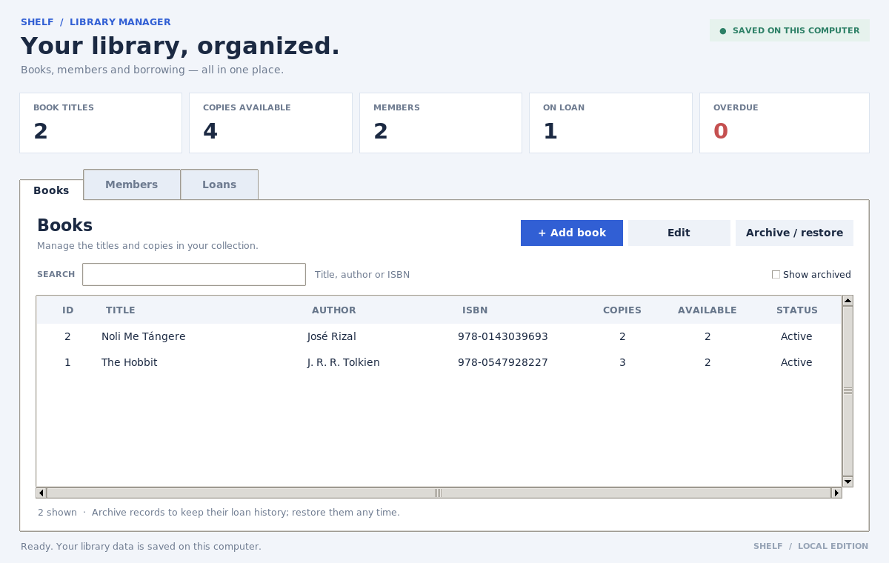

# Shelf — Library Management System

A beginner-friendly desktop application for managing books, members, and loans. Built with Python, Tkinter, and SQLite. The app runs on your computer; GitHub stores the project files, not a running copy of the app.



*The screenshot uses example records. A new installation starts with an empty library.*

## What it can do

- Add and edit books, including their author, optional ISBN, and number of copies.
- Add and edit library members and optional contact information.
- Issue available copies, set due dates, and record returns.
- Search books, members, and loans; filter for active, overdue, or returned loans.
- See counts for titles, available copies, members, active loans, and overdue loans.
- Archive and restore books or members while keeping their loan history.
- Save everything locally in an SQLite database.

## Requirements

- **Python 3.10 or newer**, including Tkinter and SQLite. These are included with most standard Python installations.
- A computer with a graphical desktop: Windows, macOS, or Linux.
- No additional Python packages are needed.

## Run the app

1. Download or clone this project and open a terminal **inside the project folder** (the folder containing `app.py`).
2. On Windows, run:

   ```powershell
   py app.py
   ```

   If `py` is unavailable, try `python app.py` instead. You can install Python from [python.org](https://www.python.org/downloads/); on Windows, selecting **Add Python to PATH** during installation can help.

   On macOS or Linux, run:

   ```bash
   python3 app.py
   ```

3. The **Shelf** window should open. The first time you run it, the app creates an empty database automatically.

> **Linux:** If you see `No module named tkinter`, install the Tkinter package for your Python version. On Debian or Ubuntu, for example, use `sudo apt install python3-tk`.

### First steps

1. Open **Books** → **+ Add book** and enter a title, author, and number of copies. ISBN is optional.
2. Open **Members** → **+ Add member**. Contact information is optional.
3. Open **Loans** → **+ Issue book**, choose a book and a member, and set the due date as `YYYY-MM-DD`. The default is 14 days from today.
4. When a book comes back, select its loan and click **Mark returned**. Use the **Show** filter to find returned or overdue loans.
5. To remove a book or member from the active lists without losing history, select it and click **Archive / restore**. Enable **Show archived** to find and restore it. All active loans must be returned before their book or member can be archived.

## Your data and privacy

By default, the database is `data/library.sqlite3` inside the project folder. It is created when you first run the app. To back it up, **close the app first**, then copy this file somewhere safe. Restoring a backup replaces the current database.

The included `.gitignore` excludes the `data/` folder and common database files from Git. Check what you are uploading before publishing: do not upload real member information to a public repository. GitHub does not automatically synchronize the local database.

This is a **learning project for local use**, not a production library service. It has no user accounts, access control, encryption, automatic backups, online sync, fines, or multi-branch management. Anyone with access to the database file may be able to read its contents. Avoid using real personal information unless you provide appropriate security and privacy safeguards.

You can use a different database location, if needed:

```bash
python3 app.py --database /path/to/another-library.sqlite3
```

On Windows, use `py app.py --database "C:\path\to\another-library.sqlite3"` instead. A custom database outside the ignored `data/` folder should also be kept out of Git.

## Upload this project to GitHub

### Option A: Use the GitHub website

1. Sign in to GitHub and go to [Create a new repository](https://github.com/new).
2. Name the repository `library-management-system` and choose **Public** or **Private**. Leave the README, license, and `.gitignore` initialization options unchecked so the repository starts empty. Click **Create repository**.
3. On the new repository page, choose **uploading an existing file** (or **Add file → Upload files**).
4. If you downloaded a ZIP, extract it. Open the extracted `library-management-system` folder and upload its **contents**—including `app.py`, `database.py`, `README.md`, `.gitignore`, `docs/`, and `tests/`. Do **not** upload the `data/` folder or any database files.
5. Enter a commit message such as `Add library management system`, then click **Commit changes**.

Some file managers hide files beginning with a dot. If you cannot see `.gitignore`, enable hidden files, or create a file named `.gitignore` in your GitHub repository and copy in the contents of the supplied file. Always check that database files are excluded.

### Option B: Use Git in a terminal

Create an **empty** GitHub repository first, then run these commands inside the project folder. Replace `YOUR_USERNAME` with your GitHub username:

```bash
git init
git add .
git commit -m "Add library management system"
git branch -M main
git remote add origin https://github.com/YOUR_USERNAME/library-management-system.git
git push -u origin main
```

GitHub may prompt you to authenticate using your browser or a credential manager. Do not put passwords or access tokens in project files. If Git asks for your name and email before committing, configure them with `git config --global user.name "Your Name"` and `git config --global user.email "you@example.com"`.

## Run the tests

From the project folder:

```bash
python3 -m unittest discover -s tests -v
```

On Windows, use `py -m unittest discover -s tests -v`. The tests use temporary databases and do not change your library data.

## Project structure

```text
library-management-system/
├── app.py                 # Desktop interface and entry point
├── database.py            # Database operations and library rules
├── README.md
├── .gitignore
├── docs/
│   └── screenshot.png     # Example screen for the README
└── tests/
    └── test_database.py   # Automated tests
```

When the app is run, it also creates `data/library.sqlite3`; that local file is intentionally not included in the repository.
